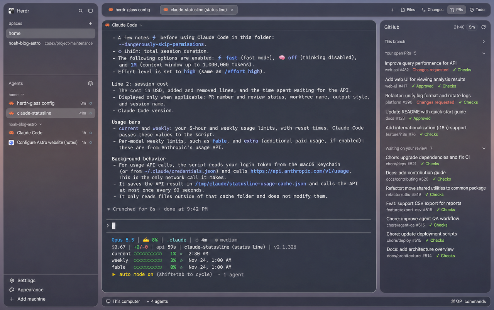

# Herdr Glass

A dark frosted-glass layout for the [Herdr](https://herdr.dev) desktop app: translucent
rounded cards over a soft background picture, a Ghostty-coloured terminal, agents grouped
by space, and an Appearance dialog for the picture and how see-through the glass is. It
restyles Herdr's own window and adds no panels of its own.



Version 0.1.0, built on herdr-app 0.1.16. What changed in each version is in
[CHANGELOG.md](CHANGELOG.md).

## Features

- **Glass cards.** The sidebar, tab bar, side panel and status bar are translucent
  rounded cards, and terminals sit in rounded frames, over a background picture. One
  spacing runs through all of them, so tabs, pane headers and sidebar rows line up.
- **Appearance** (sidebar footer), where every click applies at once:
  - **Glass**: Clear, Light, Medium, Tinted or Solid, for brighter pictures.
  - **Image**: pick the background. **Open folder** shows
    `~/.config/herdr-app/backgrounds/`; add or delete pictures there. Sunset, Ocean,
    Forest, Violet, Rose and Aurora are copied in the first time you open the dialog,
    and Default (Graphite) is always there.
  - **Components**: **Glass** uses the restyled Spaces, Agents, pane headers and
    notifications; **Herdr** puts Herdr's own back, which update with Herdr.
- **Agents grouped by space.** Click a space's name to fold it; the sort button beside
  "Agents" switches to Herdr's priority view.
- **Notifications** with a colour bar by level and the agent's live title.

## Install

Ask your agent, from a terminal in Herdr:

```
Read ~/.config/herdr-app/AGENTS.md, then add this layout: https://github.com/noah4520/herdr-glass
```

It reads every file before adding the layout, its theme (`themes/herdr-glass.json`) and its
mods. Or install it yourself:

```sh
git clone https://github.com/noah4520/herdr-glass.git
cd herdr-glass
./scripts/install.sh
herdr-app do layout.switch '{"name":"herdr-glass"}'
```

The installer copies the files listed under [What's inside](#whats-inside) into
`~/.config/herdr-app` and checks each mod. It never touches Herdr's own layouts and mods,
and it stops if one of Herdr Glass's files is already there. Your current layout stays as it
is: `ctrl-shift-l` switches between layouts.

**What it needs**

- The Herdr app, opened at least once. Herdr Glass is built and tested on herdr-app
  0.1.16,
  on macOS. Linux should work but is untested; Windows isn't supported (Appearance
  runs `sh`).
- Optional: MesloLGM Nerd Font Mono for the terminals
  (`brew install --cask font-meslo-lg-nerd-font`). Without it they use JetBrains Mono.

**Names.** Every file is named after the layout: `layouts/herdr-glass.json`,
`themes/herdr-glass.json` and mods starting with `herdr-glass-`, so it sits beside other
shared layouts and mods without clashing. If the installer says a file exists and it
isn't from an earlier Herdr Glass, don't use `--force`: it would replace that file.

## Update and remove

To update, pull and install over the old files:

```sh
git pull
./scripts/install.sh --force
```

`--force` replaces the layout file too, so the Appearance choices (glass level,
background, components) go back to the defaults. Pictures in `backgrounds/` are kept.

To remove Herdr Glass, switch to another layout (`ctrl-shift-l`) and delete its files:

```sh
cd ~/.config/herdr-app
rm -r layouts/herdr-glass.json layouts/herdr-glass.svg themes/herdr-glass.json \
  mods/herdr-glass-tabs mods/herdr-glass-chrome mods/herdr-glass-spaces mods/herdr-glass-agents \
  mods/herdr-glass-status mods/herdr-glass-pane mods/herdr-glass-toast mods/herdr-glass-bg
```

`backgrounds/` holds your pictures and the copied presets; delete it too if you don't
want them.

## What it runs and stores

- **Appearance** (`mods/herdr-glass-bg`): lists `~/.config/herdr-app/backgrounds/`, copies the
  preset pictures into it once, opens it in the file manager, and writes your choices to
  the shown layout's file (`layouts/<name>.json`). It refuses to change Herdr's own
  layouts.
- The cloned mods behave as Herdr's own do: the spaces list runs `git` for branch
  names and `hc` for your other machines, for example.
- Herdr Glass adds no network access of its own.

## What's inside

| Path | What it is |
|---|---|
| `layouts/herdr-glass.json` | The layout, from Herdr's `main` |
| `layouts/herdr-glass.svg` | Its picture in Herdr's settings |
| `themes/herdr-glass.json` | The layout's theme (Ghostty's default colours) |
| `mods/herdr-glass-tabs` | Tab bar without its bottom line, on the sidebar's spacing |
| `mods/herdr-glass-chrome` | Sidebar top and footer rows: fold button, Appearance entry |
| `mods/herdr-glass-spaces` | Spaces list without the letter avatars |
| `mods/herdr-glass-agents` | Agents list, grouped by space |
| `mods/herdr-glass-status` | Status bar without its top line |
| `mods/herdr-glass-pane` | Pane header with its content further in |
| `mods/herdr-glass-toast` | Notifications with a colour bar and the agent's title |
| `mods/herdr-glass-bg` | The Appearance dialog and the background presets |
| `RECIPE.md` | The brief an agent can install or rebuild Herdr Glass from |

The seven mods from `herdr-glass-tabs` to `herdr-glass-toast` are `mod.clone` copies of
Herdr's own mods (0.1.16) with small changes, so they don't follow Herdr updates. The
Components switch in Appearance puts Spaces, Agents, pane headers and notifications back
on Herdr's versions at any time; the tab bar, sidebar rows and status bar stay Herdr
Glass's.

**Panels from other mods.** The layout ships Herdr's Files and Changes panels only. A
panel mod that brings its own button (a block with `props: { button: true }`) fits in:
put its panel block in the `panel-body` stack and its button block after `tab-strip` in
the `tabs` row.

## License

Herdr Glass's own work is [MIT](LICENSE). The layout file and the cloned mods are derived from
the [Herdr app](https://github.com/herdrdev/herdr-app), which is Apache-2.0
([licenses/Herdr-Apache-2.0.txt](licenses/Herdr-Apache-2.0.txt)); [NOTICE](NOTICE) lists them and what was
changed. Icons are from [Lucide](https://lucide.dev), ISC
([licenses/Lucide-ISC.txt](licenses/Lucide-ISC.txt)). Herdr Glass is a community layout, not affiliated with or endorsed by Herdr.
