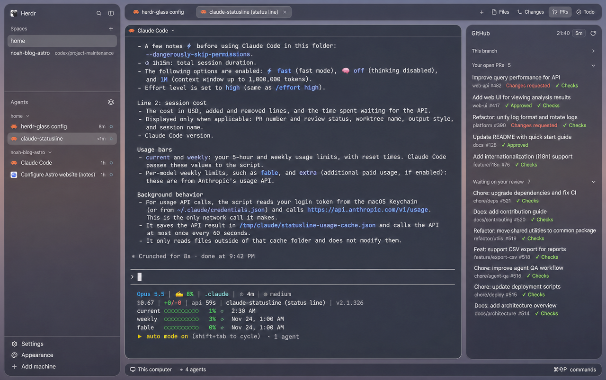

# Herdr Glass

A dark frosted-glass window for Herdr. Every region is a translucent rounded card
floating over a soft background picture, with the terminal on a neutral
dark. Agents are grouped by space, and an Appearance dialog changes the picture, how
see-through the glass is, and whether the sidebar lists are restyled or Herdr's own. It
restyles Herdr's window and adds no panels of its own. Herdr Glass 0.1.1, built on
herdr-app 0.1.18.

## What you see

Left to right, with 10px around and between every card. One spacing runs through all of
them: cards have a 16px radius, a pill inside a card (a selected row, a tab, a button)
sits 8px from the card's edge with an 8px radius, and text and icons start 16px in.

- **Sidebar** (resizable, default 250px; rail 76px): a dark glass card (`#15171d66`,
  1px `#ffffff1f` border, radius 16, large shadow).
  - Top row (46px): Herdr logo and name, search, and the sidebar fold button. The macOS
    traffic lights sit at `[24, 26]` inside this card.
  - Spaces and Agents lists (`herdr-glass-spaces`: Herdr's `spaces` without the coloured
    letter avatars; `herdr-glass-agents`: grouped by space by default, the fold chevron right
    after the space name).
  - Footer (97px): Settings, **Appearance**, Add machine.
  - Folded to a rail on macOS, the top block grows to 84px and the same fold button sits
    under the traffic lights.
- **Work column**:
  - Tab bar (42px): same glass card, radius 16. Tabs (26px pills), `+`, and the Files
    and Changes panel buttons.
  - Terminal panes: radius 16, dark `#21252bd9`, 1px `#ffffff14` border, `#ffffff2e`
    when focused, a 30px header (`herdr-glass-pane`) on every pane, terminal text 16px
    in (`terminal_padding [14, 16]`).
  - Right panel (340px, hidden until a panel button is pressed): glass card, radius 16,
    holding Herdr's Files or Changes.
  - Status bar (30px): glass card, radius 12 (it is only 30px high), with
    `herdr-glass-status` in it (Herdr's `workspace-status` without its top border line,
    text 16px in).
- **Background**: Default is `mods/herdr-glass-bg/presets/graphite.jpg`, a 1600×1000 grey
  vertical gradient (light at the top, dark at the bottom, so the cards stay readable)
  with two soft blurred colour blobs and a little noise against banding, saved as a
  ~100KB JPEG. The other presets, made the same way, are Ocean, Forest, Violet, Rose and
  Aurora; Sunset
  (`mods/herdr-glass-bg/default-bg.png`) is slate `#5c627a` → peach `#b0928a` → `#4e4a54` →
  `#1c1e24` with soft warm blobs.
- **Type**: terminals in MesloLGM Nerd Font Mono 14, weight 400, line height 1.12
  (falls back to JetBrains Mono if the font isn't installed); UI in Geist.
- **Colors**: theme `herdr-glass` (a neutral dark: background `#282c34`, the Tomorrow Night
  ANSI palette, foreground `#d2d4d8`); accent `#81a2be`; done `#8cc27d`; popover
  `#1a1c22eb`, so the command palette, menus and dialogs match the dark glass cards;
  surface `#24272ef7` (near-opaque), because gpui-kit draws every tooltip in `surface`.

## How it behaves

- Agent status in the sidebar and tabs as in Herdr: working spinner (amber), blocked,
  done (green `#8cc27d`), idle.
- **Fold**: the sidebar button folds to the rail and unfolds back to the last width.
  Dragging the sidebar narrow also gives the rail and its taller top block.
- **Appearance** (sidebar footer, palette icon; mod `herdr-glass-bg`, named for the
  background pictures it holds): a dialog styled like Herdr's Settings: a title, no
  buttons, every click applies at once, Esc or a click outside closes it (not `modal`). Refuses Herdr's own layouts (they reset on start). Three sections:
  - **Glass**, a segmented control for how see-through the cards are, for bright
    pictures: Clear / Light (default) / Medium / Tinted / Solid = card alpha
    `40`/`66`/`99`/`c2`/`eb` on `#15171d` (sidebar, tabs, status, panel) and pane alpha
    `bf`/`d9`/`e6`/`f0`/`fa` on `#21252b`; the shown level is the one closest to the
    sidebar's alpha.
  - **Image**, with "Open folder" at the section's top right: it opens
    `~/.config/herdr-app/backgrounds/` in Finder, and people add or delete pictures
    there themselves (no editing in the dialog). Thumbnails are Default (Graphite,
    `mods/herdr-glass-bg/presets/graphite.jpg`, always there) plus every image in that
    folder, by file name without the extension; the list rereads the folder every 3s
    while open. The first time the dialog opens, the other presets are copied in:
    `Sunset.png` (`default-bg.png`) and `Ocean`, `Forest`, `Violet`, `Rose`, `Aurora`
    `.jpg` (from `presets/`); a `.glass-presets-2` marker keeps a deleted one deleted. A
    folder seeded by the first version (`.glass-presets-copied`) only gets Sunset and
    loses its untouched Graphite copy. Click a picture to apply it; if the one in use is
    gone from the folder, the background goes back to Default.
  - **Components**, one Glass / Herdr switch for every restyled block at once, so
    people can take Herdr's own versions (which update with Herdr): Spaces
    (`herdr-glass-spaces` ↔ `spaces`), Agents (`herdr-glass-agents` ↔ `agents`), pane headers
    (`herdr-glass-pane` ↔ `pane`) and notifications (root `toast` key
    `herdr-glass-toast` ↔ no key). It rewrites each block's `content.mod`.
    A line under it says what the current choice means; if the blocks were mixed by
    hand, neither side is lit and either click makes them agree. The tab bar and sidebar
    chrome aren't offered: Herdr's versions draw their divider lines and have no
    Appearance entry to reopen the dialog.
- **Notifications** (`herdr-glass-toast`): a 3px colored bar by level (success = done green,
  error = blocked, warning = working, info = accent). For agent notifications the body
  is "space · the agent's live title" instead of Herdr's "space / tab name".
- Panel choice (Files / Changes) is remembered per space, as in Herdr.

## Built from

- `layouts/herdr-glass.json`: cloned from Herdr `main` 0.1.18. Root: `titlebar: none`,
  `traffic_lights [24, 26]`, `toast: herdr-glass-toast`, `theme: herdr-glass`, `colors` overrides
  (`canvas`/`chrome`/`background` transparent so the cards and gradient show),
  `terminal_opacity: 0` (the rounded pane frame paints the dark, not the square terminal),
  `padding 10`, `gap 10`, `preview: layouts/herdr-glass.svg`.
- `themes/herdr-glass.json`: the layout's own theme (a neutral dark with the Tomorrow Night palette).
- Mods (`mod.clone` copies of Herdr's 0.1.18, except `herdr-glass-bg`):
  - `herdr-glass-tabs` (from `tabs`): drops the bar's bottom border and uses the
    spacing above (8px edge padding, 26px pills with an 8px radius). When its block has
    blocks after it in its row, it leaves them the right edge and ends with a 3px gap.
  - `herdr-glass-pane` (from `pane`): the pane header, its content 16px in instead of
    10px. A layout can't pad a pane header, hence the clone.
  - `herdr-glass-chrome` (from `workspace-chrome`): fold button under the traffic lights on
    the macOS rail (resizes `brand` 46 ↔ 84), Appearance row (palette icon) in the footer.
  - `herdr-glass-spaces` (from `spaces`): no coloured letter avatar in front of a space.
  - `herdr-glass-agents` (from `agents`): grouped by space unless the person picks Priority;
    the fold chevron right after the space name (down open, right folded); the rail's
    `»` unfold button removed.
  - `herdr-glass-toast` (from `toast`): bar by level, agent title in the body.
  - `herdr-glass-status` (`mod.clone` of `workspace-status`): drops the bar's top border. A
    theme `colors: {border}` override on the block didn't reach the mod, so it's a clone.
  - `herdr-glass-bg`: the Appearance dialog; `exec` runs `ls` and `sh` (copy the presets
    once, `mkdir`, then `open` or `xdg-open` on the folder); reads and writes
    `layouts/<shown>.json` with `readTextFile` / `writeTextFile`.
- The tab bar is a row card `tabs` (42px, not resizable) holding one block `tab-strip`
  with `herdr-glass-tabs`. A mod that brings its own panel button, as a block with
  `props: { button: true }`, goes after `tab-strip` in that row; the layout ships none.
- Panel stack `panel-body`: `files` and `changes` (Herdr's).
- The cloned files come from the Herdr app (Apache-2.0): `NOTICE` lists them, and each
  clone's `main.js` starts with what was changed. Icons are Lucide's (ISC). Both
  licenses are in `licenses/`.
- `VERSION` holds the release number; `CHANGELOG.md` says what each one changed.
- `scripts/install.sh` copies the layout, theme and mods into `~/.config/herdr-app`
  (refusing to overwrite without `--force`) and runs `herdr-app check` on each mod.

## Watch out

- A scrollbar wraps its list, so `max_h` on an `overflow_y_scrollbar()` element never
  reaches the layout and it doesn't scroll (an `absolute().inset_0()` list with it
  doesn't either). The Appearance image grid gives an outer column the height (rows ×
  144 − 6, at most two rows) and fills it with a `flex_1().min_h(0)` scrolling list, as
  Herdr's spaces and files lists do.
- A pane's border is drawn on the pane's dark fill, so it is one fixed grey all round and
  doesn't follow the picture behind. Over a picture that is bright at the top and dark at
  the bottom, a strong white border (`#ffffff5c`) reads darker than the picture at the top
  and as a bright line at the bottom, like a gradient. Keep it faint enough to stay below
  the picture's darkest part: `#ffffff2e` focused, `#ffffff14` otherwise.
- Herdr caches an image it has drawn by path: overwriting a background file shows the
  old picture. Give a changed picture a new file name.
- Layout `background.gradient` takes only two stops; the three-colour sunset needs an
  image.
- A pane header paints the theme's `background` square; with an opaque `background` it
  pokes out of the rounded frame. Keep `colors.background` transparent.
- `terminal_opacity` above 0 draws the terminal's square backdrop over the rounded
  frame's bottom corners.
- The command palette is Herdr's own screen (`frame/palette`, rewritten on start): only
  theme colors restyle it. Close it with `app.palette` again; `overlay.close` may not.
- Tooltips can't be placed or styled from a mod: gpui-kit positions them and paints them
  in the theme's `surface`. A translucent `surface` makes every tooltip see-through.
- MesloLGM Nerd Font Mono has no Light face: `font_weight` below 400 changes nothing.
- The cloned mods don't follow Herdr updates; re-clone (`herdr-app do mod.clone`) and
  re-apply the changes above when Herdr changes `tabs`, `workspace-chrome`, `spaces`,
  `agents`, `pane`, `workspace-status` or `toast`. Most changes carry a `glass:` comment; diff a
  clone against Herdr's copy in `~/.config/herdr-app/mods/` for the full list.
- "Open folder" uses `open` (macOS), falling back to `xdg-open`, through `sh`, so it
  doesn't work on Windows. Only macOS is tested.
- Every file carries the layout's name (`herdr-glass.json`, `herdr-glass-*`) so it sits
  beside other shared layouts and mods; plain `glass` and `glass-*` names are taken by
  others.
- Theme colors can already carry alpha (`dim` is `#ffffff80`): never append alpha digits
  to a theme color; replace its alpha.
- Herdr's bars draw a straight 1px divider (`border_b` / `border_t`) that runs past a
  rounded card's corners; remove it in the clones and let the card's border frame them.
- `toLocaleTimeString` options are ignored in the mod runtime; format times by hand.

## Done when

- `herdr-app check` passes for all eight mods and `herdr-app status` shows no errors with
  the layout shown.
- Folding the sidebar shows the fold button under the traffic lights; unfolding restores
  the previous width.
- The tab bar shows Files and Changes buttons only, and each opens its panel in the
  right-hand glass card.
- Appearance lists Default plus the `backgrounds/` pictures (the presets copied in on
  first open), and picking one changes the window within a second. The Components
  switch moves Spaces, Agents, pane headers and notifications between the restyled and
  Herdr's versions.
- Pane corners are rounded on all four sides with no square edges showing.
